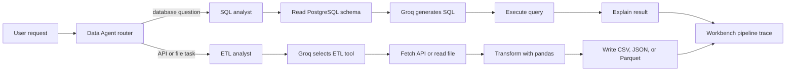

# Data Agent

Data Agent is a Python project that routes natural-language data requests to one of two workflows:

- **SQL analysis:** generate a PostgreSQL `SELECT`, run it against the configured database, and explain the result.
- **ETL:** fetch API data or read a local CSV, JSON, or Parquet file; transform it with pandas; and save the output.

The project includes a local browser workbench that submits requests to the same LangGraph used by the command-line entry point.

## How a request moves through the project



The router currently uses request keywords to choose the SQL or ETL path. The specialist agents use a Groq model for SQL generation, tool selection, and final responses. The workbench displays the request, selected route, generated SQL or ETL tool result, and final answer when available.

## When to use it

Use the SQL path when data is already loaded into PostgreSQL and you want counts, filters, groupings, or other read-only analysis.

Use the ETL path when you want to extract data from an API or transform a local data file and save it in a common format.

Example requests:

```text
How many rides are in the rides table?
```

```text
Extract the data from https://pokeapi.co/api/v2/pokemon and save it to data/extract in CSV format.
```

```text
Transform data/extract/extracted_data.csv. Keep rows where the name is bulbasaur and save the result to data/transform as CSV.
```

## Requirements

- Python 3.11 or later
- PostgreSQL, for SQL requests
- A Groq API key
- Outbound HTTPS access to Groq, and to the source API for API extraction

## Setup

Run these commands from the project root (`D:\Data_Agent` on the current development machine).

### Install dependencies

This project uses `pyproject.toml` and `uv.lock`:

```powershell
uv sync
```

To run commands with the project environment on Windows:

```powershell
.\.venv\Scripts\python.exe path\to\script.py
```

Or activate the environment first:

```powershell
Set-ExecutionPolicy -Scope Process -ExecutionPolicy RemoteSigned
.\.venv\Scripts\Activate.ps1
```

### Configure environment variables

Create or update a `.env` file in the project root. Keep this file private; it is ignored by Git.

```env
GROQ_API_KEY=your_groq_api_key
host=localhost
port=5432
user=postgres
password=your_postgres_password
database=postgres
```

The database settings are read by `utils/database.py` and `feed_db.py`. `GROQ_API_KEY` is used by the SQL and ETL agents.

### Load the sample database

Start PostgreSQL and ensure the database in `.env` exists. Then create the project tables and load the CSV files in `data/`:

```powershell
.\.venv\Scripts\python.exe feed_db.py
```

The SQL examples use the `public` schema and tables such as `rides`, `payments`, `users`, `vehicles`, and `ratings`.

## Run the browser workbench

Start the local server from the project root:

```powershell
.\.venv\Scripts\python.exe frontend\server.py
```

Open <http://127.0.0.1:8765>. The server must remain running while you use the page. Enter a request or select an example, then click **Run pipeline**. On completion, the output panel shows the route and the pipeline stages returned by the agent. Press `Ctrl+C` in the server terminal to stop it.

The server binds to `127.0.0.1` and is intended for local development. SQL tasks require PostgreSQL; all LLM tasks require outbound access to Groq. API extraction also requires outbound access to the requested API.

## Run from the command line

`main.py` runs the Data Agent with its sample API extraction request:

```powershell
.\.venv\Scripts\python.exe main.py
```

## Output locations

- API extraction writes `extracted_data.<format>` in the requested output folder. For example: `data/extract/extracted_data.csv`.
- File transformation writes `transformed_data.<format>` in the requested output folder. For example: `data/transform/transformed_data.csv`.
- SQL requests return the query result and a natural-language answer in the workbench.

Supported output formats are CSV, JSON, and Parquet. Parquet support uses PyArrow.

## Project structure

```text
agents/
  data_agent.py       Routes requests to SQL or ETL
  etl_agent.py        ETL tools and LangGraph workflow
  sql_analyst.py      PostgreSQL query workflow
frontend/
  index.html          Browser workbench UI
  server.py           Local HTTP server and graph endpoint
utils/
  database.py         PostgreSQL access and .env configuration
  etl_tools.py        API/file extraction and pandas transforms
  llm_pick.py         Groq model setup
Models/
  schema.py           LangGraph state definitions
data/                 Sample CSVs and generated output folders
feed_db.py            Creates sample tables and loads CSV data
main.py               Command-line Data Agent entry point
pyproject.toml        Python dependencies and project metadata
uv.lock               Locked dependency versions
```

## Prototype limitations

This is a local learning project, not a production data platform. SQL prompts request `SELECT` statements, but the current code does not implement a full SQL safety or approval layer. ETL transformations execute model-generated Python code. Use a development database and non-sensitive data, and inspect generated work before relying on it.

The workbench displays the stages returned after a run; it does not stream live progress while the model is working.
